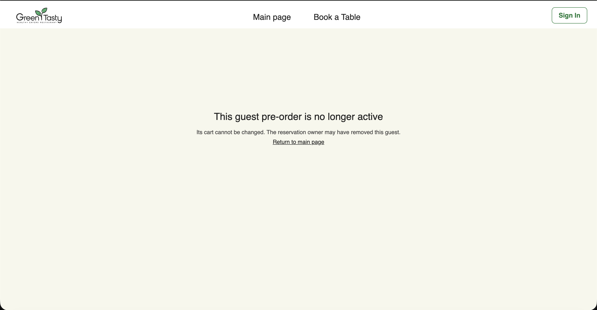
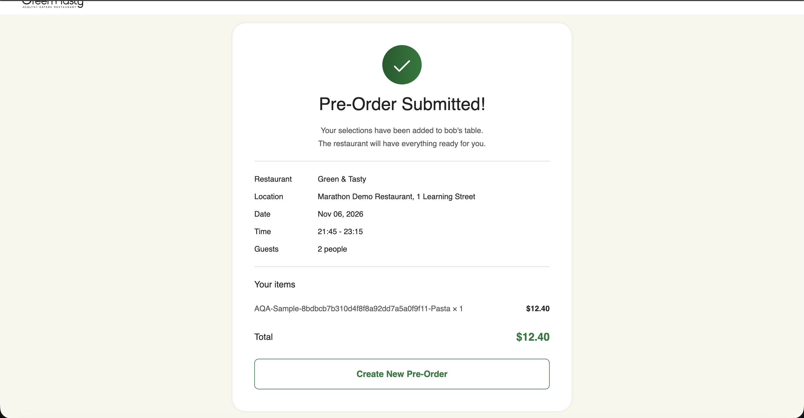
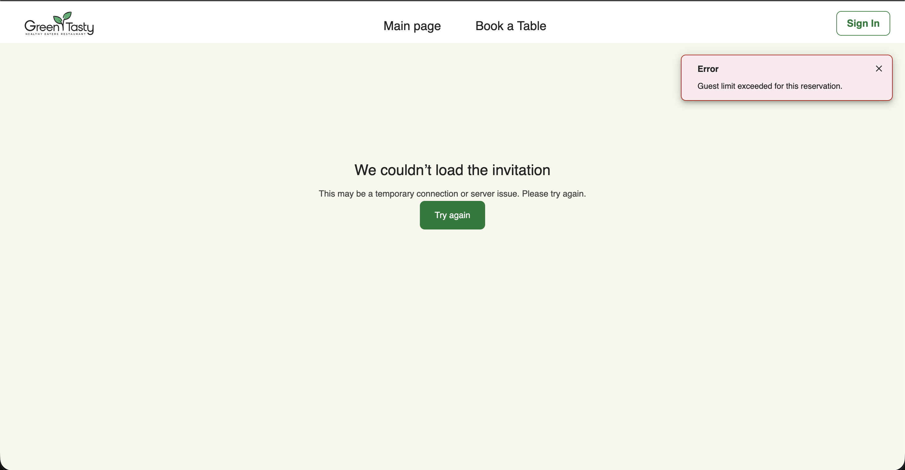
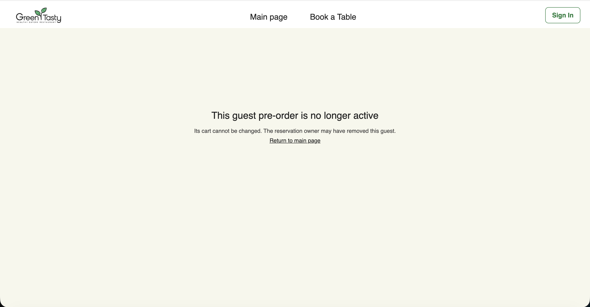

# Removed guest synchronization follow-up

## Report

After the Owner removed a guest, that guest's already-open menu could still
offer dish controls. The Owner could later see the removed guest again. This was
reported during manual Level 3 checking on 2026-11-01.

## Changes

- Guest-session lookups now verify the current DynamoDB base-table record with
  a strongly consistent read. This filters deleted sessions that may still be
  visible through a group or token index.
- Cart updates use a conditional DynamoDB update that requires the session to
  exist and still belong to the same group. A delayed write cannot recreate a
  session after its deletion.
- An open guest menu checks its session every 15 seconds and when its window
  regains focus. A revoked session clears local credentials and cart state,
  hides the menu, and explains that the pre-order is inactive. A failed add,
  remove, or submit also checks for revocation immediately.
- The live AQA suite checks that the old token cannot add a dish, watches the
  Owner group for a delayed reappearance, and exercises the open guest page.

The pre-fix live API check rejected an immediate old-token add in one run; it
did not reproduce the intermittent report. The change addresses the stale-read
and delayed-write paths identified in code. The browser scenario supplies
direct evidence for the open-page behavior after deployment.

## Manual screenshot

The screenshot supplied after deployment shows the removed guest's open page
displaying the inactive message instead of the editable menu. It documents
the guest-facing result; the automated API and browser checks below cover the
Owner view and the old session token.

## Verification

- Backend tests: 276/276 passed.
- Frontend tests: 359/359 passed. The production build and bundle check passed.
- Terraform plan changed only the API Lambda package, function, and alias;
  apply completed with 1 added, 2 changed, 1 destroyed.
- Frontend build published to the existing S3/CloudFront site; cache
  invalidation completed.
- Rebuilt live Level 3 API suite: 10/10 passed, including five Owner snapshot
  reads over eight seconds after the removed guest tried to add a dish.
- Live Level 3 browser suite: 2/2 passed
  (`TestResults/level3-20261101T185717Z-50224ccb/`). The added browser case
  kept the removed guest's tab open, observed the inactive message without a
  reload, then reloaded the Owner page and confirmed the guest stayed absent.
- Post-fix live Level 1 browser suite: 3/3 passed
  (`TestResults/level1-20261101T191907Z-8ff12ae7/`), including the previously
  intermittent guest-submit status update without an Owner reload. A repository
  regression test verifies that a current `isSubmitted=true` record wins over
  a stale `false` group-index result.

## Reload follow-up

Manual checking showed that reloading a removed guest's page could return to
the invitation form, while the old open page could still display dish controls.
The guest store previously marked a session as verified only after a menu load.
On a reload after removal, the first menu request returned 401, so the page
showed a generic menu error and never entered the inactive state. A focused
frontend test reproduced that failure before the fix.

Restored sessions now treat a 401/404 menu response as revocation. The page
also stores an inactive marker for this browser and invitation, so subsequent
reloads keep the inactive message and do not restore the old cart or token.
The original open-tab polling and rejected cart-write behavior remain in place.

The follow-up frontend test suite passed **361/361**. Its production build and
bundle check passed, and the build was published to CloudFront. The updated
live Level 3 browser suite passed **2/2**
(`TestResults/level3-20261101T194758Z-1b54e303/`), including the guest's
open tab becoming inactive without a reload and staying inactive after a
reload. This verifies the deployed browser behavior for a removed session.

Removing a guest session does not revoke the shared invitation. Someone using
the link in another browser can create a new guest session while the group is
open; preventing that would require a separate invitation-access rule.

## Submitted guest follow-up

Manual screenshots exposed another path: after a guest submitted a cart, the
success screen still offered **Create New Pre-Order** after the Owner removed
that guest. The submitted screen did not check session validity. Its button
created a fresh session from the still-valid shared invitation, so the Owner
could see a guest again. Repeated new sessions could fill the reservation and
produce a `Guest limit exceeded` invitation error. The screenshots record the
reported pre-fix state; neither screenshot by itself identifies the session ID
or proves a successful cart write.

The submitted success screen now checks its old session during polling. The
**Create New Pre-Order** action also checks that session before it creates a
new one. If the Owner removed the old session, the page switches to inactive
and cannot create a replacement from that window. An existing submitted
session can still create another pre-order, as the original flow intended.

The new focused tests failed 2/7 before the change and passed 8/8 afterward,
including the valid Create New path. The clean full frontend run passed
**364/364**, and its production build and bundle check passed. After publishing
the build and completing CloudFront invalidation, the live Level 3 browser
suite passed **2/2** (`TestResults/level3-20261101T203602Z-e1882714/`).
The confirmed-guest scenario now attempts **Create New Pre-Order** after Owner
removal and waits for the inactive page; the other scenario still verifies a
draft guest's open menu and reload behavior.

That describes the 2026-11-01 test version. On 2026-11-02, a live run caught a
test race: the guest page became inactive between checking the button and
clicking it. The current test waits for the inactive message and confirms the
button is absent, without attempting a click that may no longer be possible.
Two focused UI runs and the full Level 3 suite passed afterward; see
[FinalRegression.md](FinalRegression.md). The application fix above was not
changed in this test follow-up.

The shared invite remains usable by someone in a separate browser. The current
homework API removes a guest *session*, not a named person or the invitation.

## Manual confirmation

The operator later confirmed that removing the submitted guest immediately
showed the inactive page in the guest window. The new screenshot was copied
into the homework evidence directory; the three original screenshot files
were removed from the repository root after their copies were hash-checked.

The first browser run failed 2/2. One new assertion expected a lower total
after removing a draft cart, although draft dishes were never included in the
submit-ready total. The older Waiter scenario loaded a reservation card before
its pre-order button was visible. We corrected the assertion and made the
test refresh that read-only dashboard while waiting for the button. The final
rerun passed. This Waiter timing behavior is separate from guest removal.

The guest page normally notices removal within 15 seconds; focusing its window
checks sooner. The server rejects a removed session regardless of the page's
polling interval. No commit or push was made as the AQA work remains in
progress.
