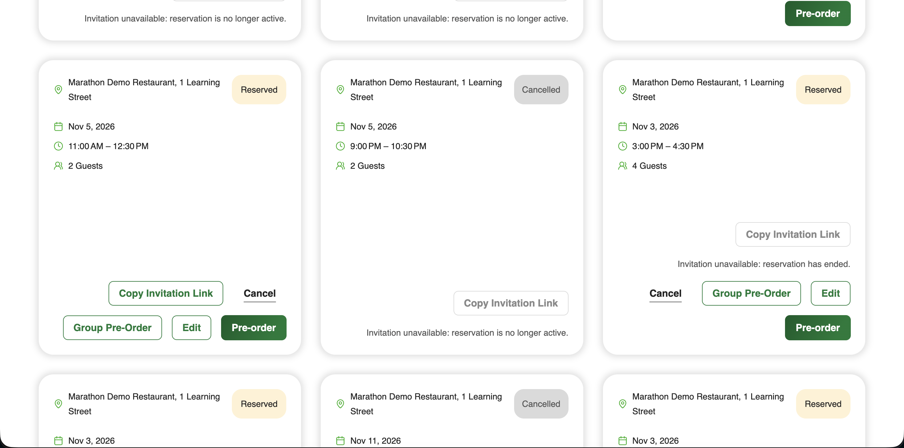

# F1 — Persistent group invitation link

**Status:** Implemented in commit `ea40dc9866b396cd6e249e8792b53d667c706d74` and deployed to the existing AWS environment on 2026-11-03. This record covers F1 only.

## Behavior

On the customer reservation dashboard, a group reservation owner can use **Copy Invitation Link** after dismissing the original booking modal or reloading the page. The action retrieves the existing token and copies the same `/join/{token}` URL format used by the [booking invitation modal](../../frontend/restaurant-frontend-app/src/app/components/reservations/reservation-invite-modal/reservation-invite-modal.component.ts). It is not shown to waiters, unrelated users, or single-guest reservations. The card disables it for inactive or ended reservations and when the group invitation is unavailable, with a visible explanation linked to the disabled button.

The [token handler](../../backend/restaurant-backend-app/dnapp/lambdas/api-handler/Handlers/GroupReservations/GetInviteTokenHandler.cs) reads the authenticated Cognito subject. The [service](../../backend/restaurant-backend-app/dnapp/lambdas/api-handler/Services/GroupReservations/GroupReservationService.cs) checks that subject against the reservation owner **before** reading the group token. It also rejects missing, inactive, ended, submitted, and closed group reservations. Existing tokens are reused; no new token is generated by the card.

## Evidence and verification

The screenshot shows the deployed card states. It does **not** prove clipboard contents or a direct non-owner API rejection. Those behaviors are covered by the [frontend card tests](../../frontend/restaurant-frontend-app/src/app/components/reservations/card-reservation/card-reservation.invite.spec.ts), [handler tests](../../backend/restaurant-backend-app/Tests/Handlers/GetInviteTokenHandlerTests.cs), and [service tests](../../backend/restaurant-backend-app/Tests/Services/GroupReservationServiceTests.cs).

- Local regression: 287/287 backend tests, 377/377 frontend tests, and 130/130 frontend homework tests passed. Frontend lint passed with 0 errors and 38 warnings; the production build and bundle check passed.
- Deployment: the reviewed Terraform plan changed only the API Lambda package, function, and alias. The frontend was built from committed source with the actual `/develop` API URL; the unrelated local CSS edits were excluded. CloudFront invalidation completed. A subsequent Terraform plan reported no changes.
- Live smoke checks: `/locations` returned HTTP 200, an unauthenticated invite-token request returned HTTP 401, and the CloudFront entry page and F1 JavaScript bundle returned HTTP 200.

An authenticated owner copy and non-owner rejection were **not** retested against AWS after deployment. A dashboard already open when another tab submits the group may show its previous button state until refresh; the server rejects token retrieval after submission.
