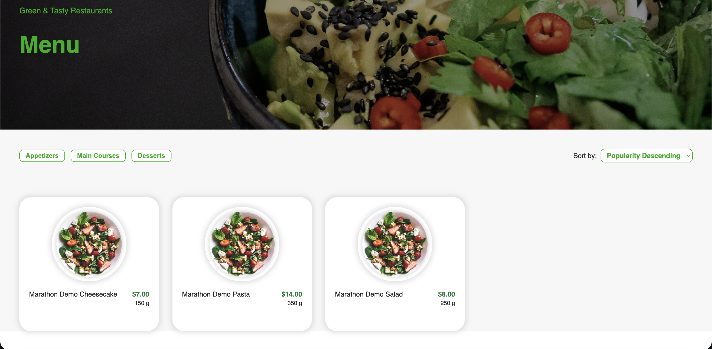
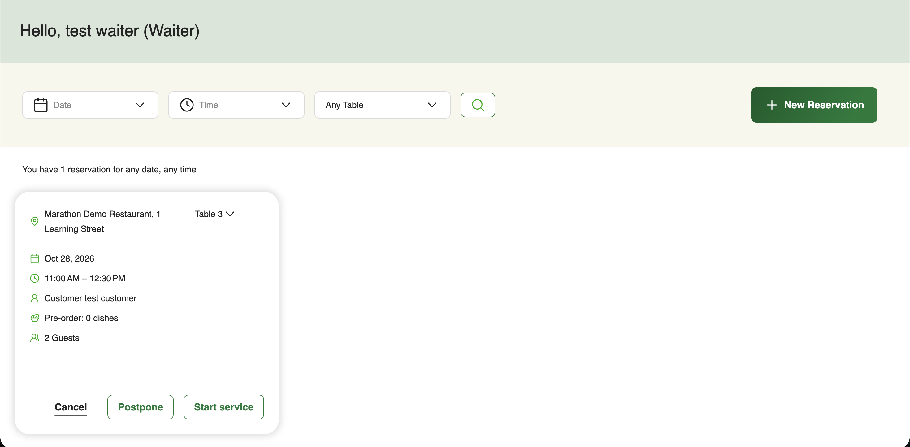
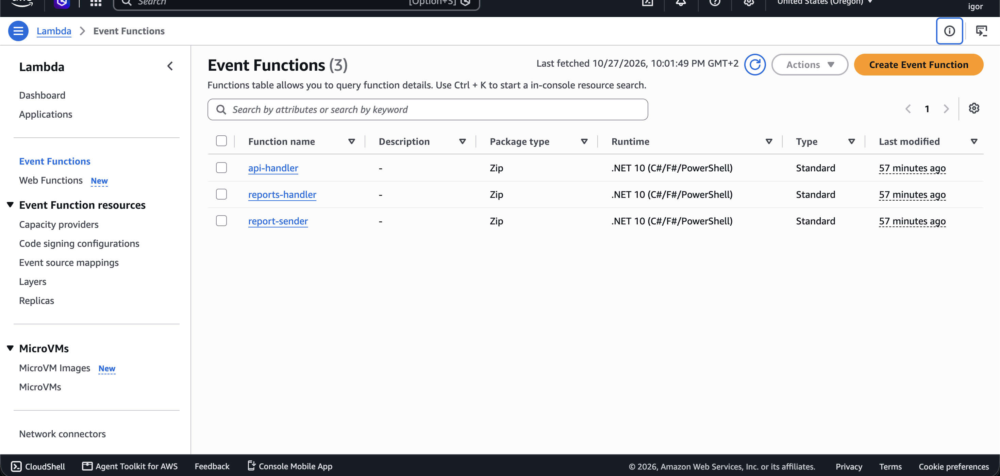
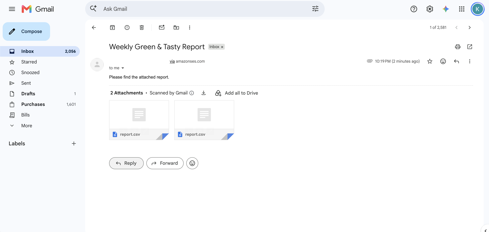

# EPAM DevOps homework — Terraform deployment verification

## Implementation

The deployment uses the existing restaurant application and Terraform to manage
Lambda, API Gateway, DynamoDB, IAM, Cognito, SQS, S3, CloudFront, CloudWatch log
groups, and EventBridge Scheduler. Syndicate is not used for this deployment.

Lambda packages are built separately with `scripts/build-lambdas.py` for Linux
x64 and the managed .NET 10 runtime. Terraform uploads packages to a private S3
bucket and deploys published versions behind `dev` aliases. API Gateway exposes
the `develop` stage. The Angular production build embeds the deployed API URL
and is uploaded to private S3 hosting behind CloudFront.

Remote Terraform state is stored in a separate encrypted, private, versioned S3
bucket with S3 lockfile locking. Personal configuration is kept in ignored
`terraform.tfvars` and `backend.local.hcl` files. No account IDs, credentials,
tokens, application passwords, or state contents are included in this report.

## Verification results

The following live results were executed and confirmed by the operator in their
terminal/browser; the agent execution environment could not access AWS directly.

| Check | Result |
| --- | --- |
| Read-only account/resource-name preflight | No collisions among checked resources |
| Three Lambda packages | Built successfully; local ZIP integrity and required assembly/config files checked |
| Frontend production build | `Bundle check passed: no configuration placeholders left` |
| Initial Terraform plan | 69 to add, 0 to change, 0 to destroy |
| Terraform apply | 69 added, 0 changed, 0 destroyed |
| Public `GET /locations` on empty database | HTTP 200, `[]` |
| Protected `GET /me` without a token | HTTP 401, `Unauthorized` |
| CloudFront website | Homepage and menu load |
| Customer registration/login/profile | Successful; registered user visible in Cognito |
| Admin group assignment and fresh login | Reports page accessible |
| Demo data through authenticated API | One location, three tables, three dishes; location and dishes visible in website |
| Waiter assignment through API | Separate registered user assigned to location; waiter page accessible |
| Customer booking and waiter view | Reservation created by separate Customer account and visible to assigned waiter |
| Post-deployment Terraform plan | No changes; deployed infrastructure matches configuration |
| SES sender setup | Operator confirmed setup apply and email verification |
| Weekly report schedule | Enabled after verification; operator confirmed 0 added, 1 changed, 0 destroyed |
| Direct report-sender email test | Operator invoked the `dev` alias, reported HTTP 200, and confirmed report email receipt |

Demo data and user-group assignments were created through the application API
or Cognito administration, not Terraform. Application records are intentionally
outside infrastructure state.

## Known limitations and follow-up

- The provider reports deprecated `hash_key`/`range_key` arguments for global
  secondary index configuration. The deployed schema is functional and the final
  plan reports no changes. Migrating those index blocks to `key_schema` is a
  separate configuration maintenance task; review a new plan before applying it.
- The .NET build completed with nullability warnings; a successful build is not
  proof that all code paths are correct. Backend unit-test execution has not been
  confirmed as part of this live verification.
- Weekly reporting was initially disabled, then enabled after the operator
  confirmed SES email verification. Direct invocation of the `dev` alias produced
  a report email received by the operator. The scheduled Friday execution itself,
  report aggregation through SQS, dead-letter behavior, report content accuracy,
  and report download formats have not been verified end to end. The schedule
  runs Fridays at 08:00 UTC and targets the report-sender `dev` alias.
- Budget email notification is configured for actual monthly account-wide spend
  exceeding 80% of the $10 budget ($8). Threshold-triggered budget email receipt
  has not been tested; billing data and notifications can be delayed.
- Registration automatically confirms accounts but does not verify email
  ownership. Cognito can therefore show a confirmed account with an unverified
  email address.
- The backend/frontend Owner homework features remain separate work. Deploying
  the application does not implement the missing Owner endpoints or screen.
- A no-change infrastructure plan does not validate application data, every API
  authorization rule, or all operational behaviors.

## Submission evidence to capture

### Attached screenshots

Menu with the three demo dishes:

Customer reservation visible to the assigned waiter:

The three deployed Lambda functions using the .NET 10 runtime:

Weekly report received after manually invoking the report-sender `dev` alias,
with two CSV attachments. This demonstrates delivery, not report content accuracy
or a scheduled Friday execution.

### Remaining evidence checklist

1. Terraform plan/apply summaries and the final no-change plan.
2. Redacted AWS Lambda list showing the three functions and their runtime.
3. API Gateway showing the REST API and `develop` stage.
4. CloudFront-hosted homepage/menu with the demo dishes.
5. Customer reservation and the same reservation in the waiter view.
6. Optional: budget notification configuration and Lambda log retention.

Redact account IDs, emails, ARNs, authentication tokens, cookies, and other
personal values before sharing screenshots. Do not submit raw Terraform state,
saved plans, private configuration files, or credentials.

AI assistance was used to inspect the existing application, translate backend
deployment configuration into Terraform, prepare local build/setup scripts,
and troubleshoot script behavior. Verification combined local static/mocked
checks with the live operator-run checks recorded above.

## Keeping, updating, and removing the deployment

Keep the environment available for the upcoming backend/frontend integration
homework if needed; AWS usage can continue to incur charges. Check Billing and
the configured budget notification. Alerts do not enforce a spending limit.

For a code update: build the Lambda packages, test, create/review a new Terraform
plan, and apply it. For frontend changes: build with the correct `BACKEND_URL`,
sync the bundle to S3, and account for CloudFront caching.

Cleanup is destructive. Follow the bucket-emptying and destroy-plan review
steps in `infra/terraform/README.md`. Do not use `syndicate clean` on these
Terraform-managed resources. Keep state until destruction finishes, and handle
the state bucket and all its object versions separately afterward.
